## UIII Act4  Importación y descripción de datos con Pandas ML
## Johan Paulo Aros NC 0016
 **🎓 Asignatura:** Soluciona problemas de Machine Learning  
> **📚 Nivel:** Tercer semestre de preparatoria  
> **🤖 Especialidad:** Inteligencia Artificial  
> **📈 Dificultad:** Cero a principiante  
> **🐍 Lenguaje:** Python  
> **🛠️ Herramientas:** Visual Studio Code, Pandas, Matplotlib y CSV 
## Tabla original de equipos
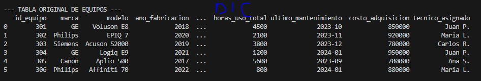

## Convertir el DataFrame en archivo CSV
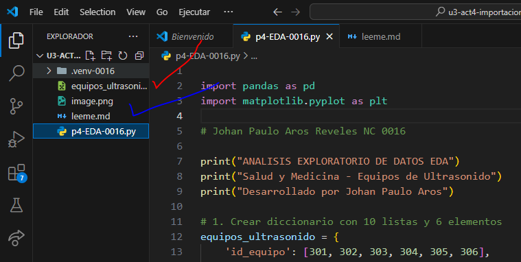

## Datos del CSV --> base de datos
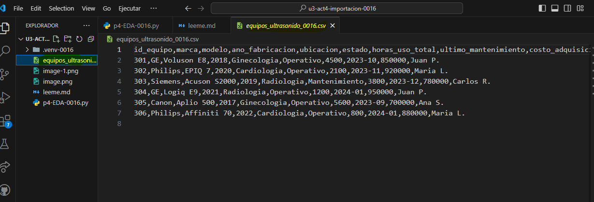

## 8. Leer los datos desde el archivo CSV
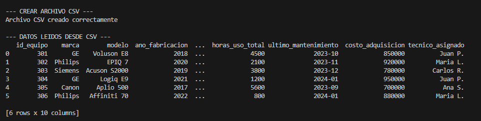

## 9. Análisis Exploratorio de Datos (EDA)
# Primeros y ultimos registros
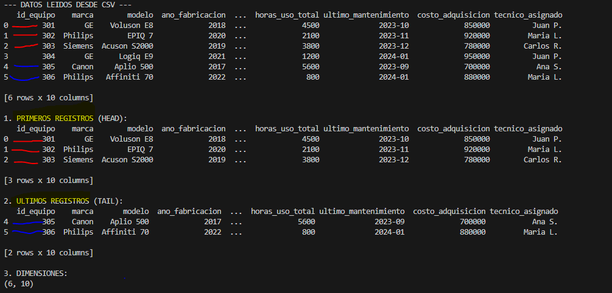

## 6 Dimensiones y estructuras
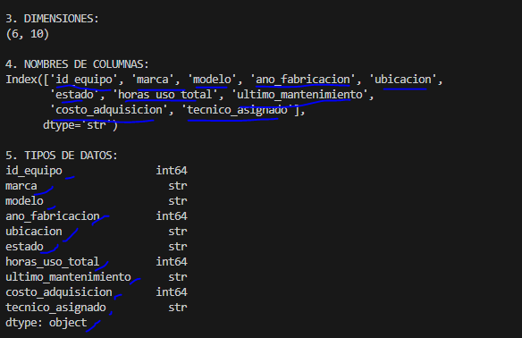

## 7 Estadisticas y limpieza
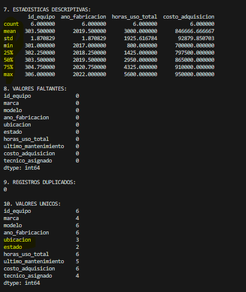

## 8 y 9 ordenamiento y agrupacion y filtado
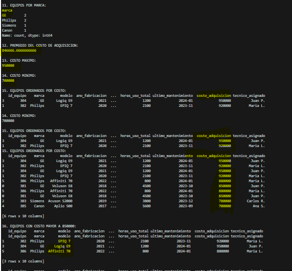

## 18 Gradica de barras: Empleados por departamento
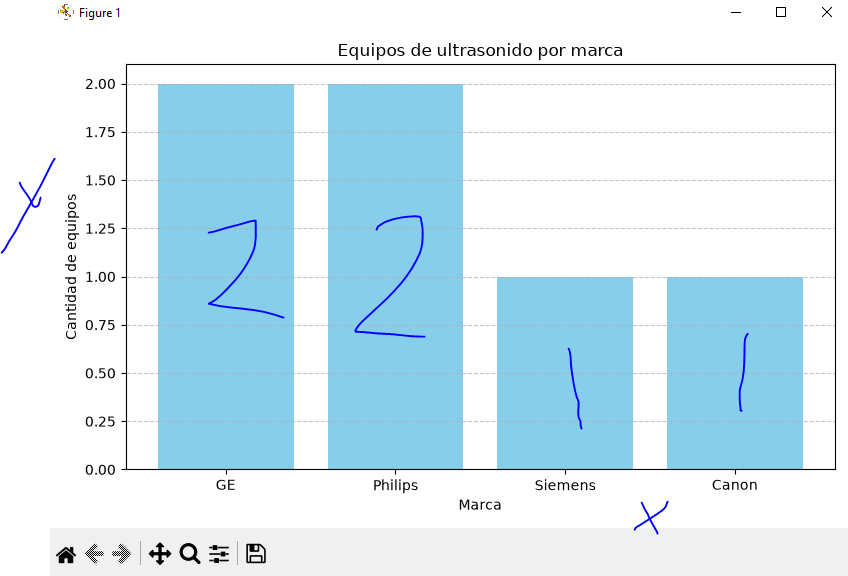

## 19. Graficas de barras:Salario por empleados
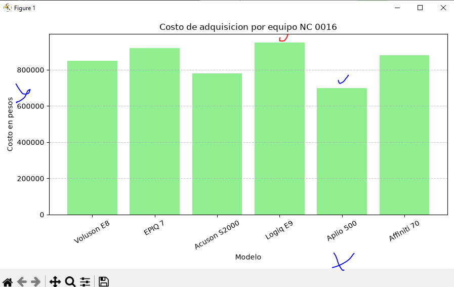

## Distribucion
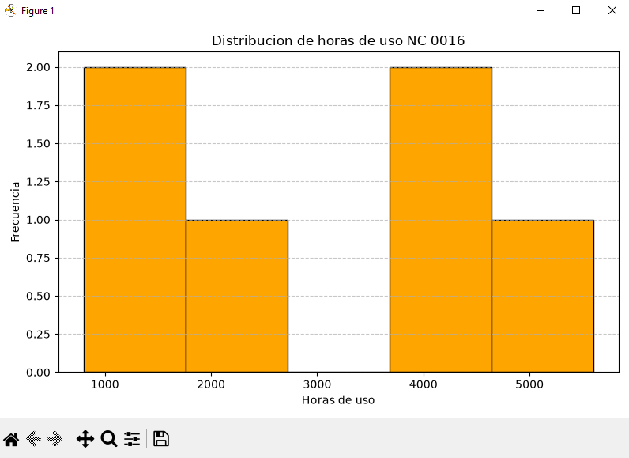

## 21. Gráfica de dispersión: Edad vs Salario
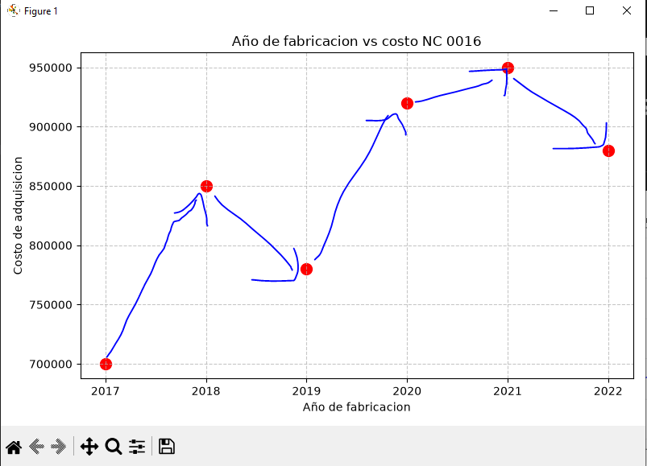

## 22. Diagrama de caja: Distribución de salarios
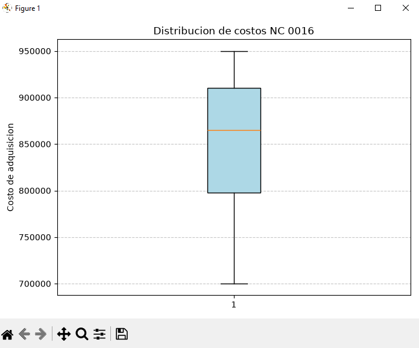

## 23 Matriz de correlación
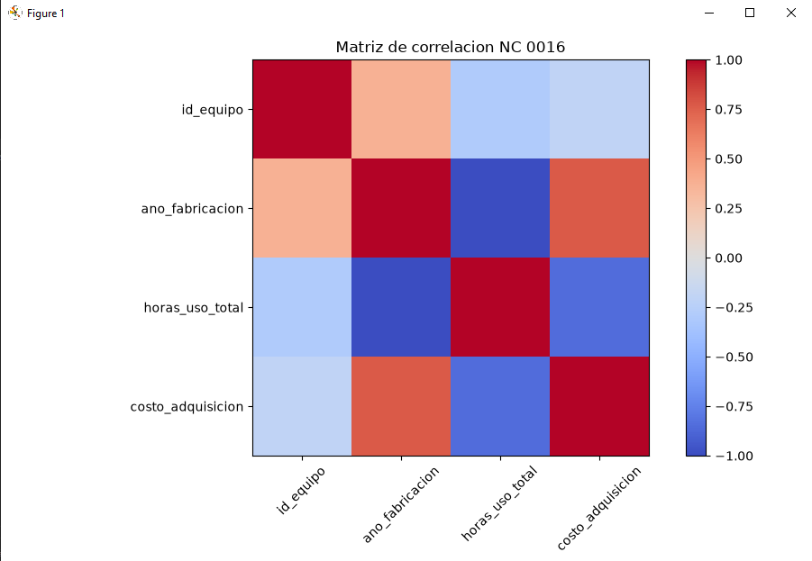